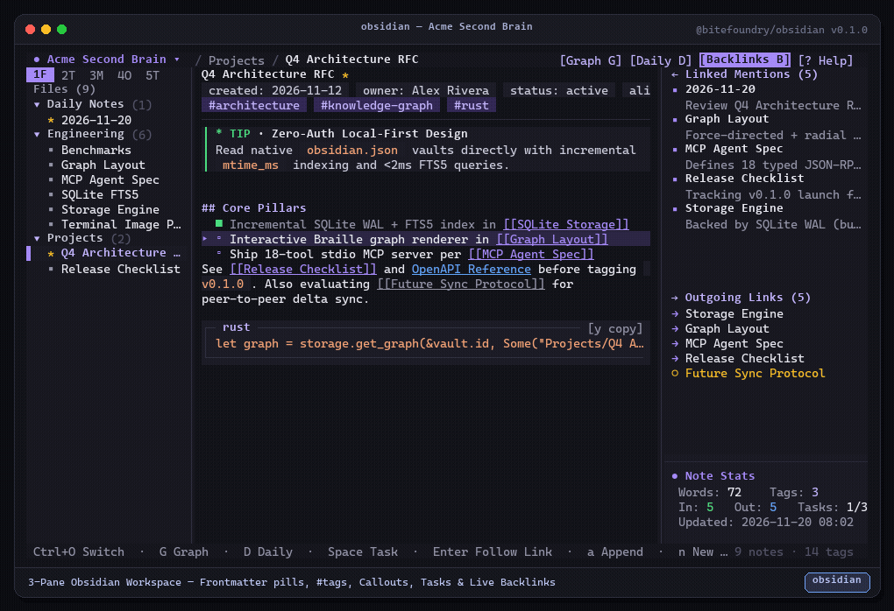

<div align="center">

# `@bitefoundry/obsidian`

**Obsidian-native terminal workspace, interactive knowledge graph & AI agent toolkit — Zero-Auth Local Vaults, Backlinks, Braille Graph View, CLI · TUI · HTTP API · MCP.**

[](https://www.npmjs.com/package/@bitefoundry/obsidian)
[](docs/NPM.md)
[](Cargo.toml)
[](package.json)

<br />



</div>

---

## Highlights

| Pillar | Capabilities |
| :--- | :--- |
| **Zero-Auth Native Vault Discovery** | Automatically discovers every local Obsidian vault from `%APPDATA%\obsidian\obsidian.json` (Windows), `~/Library/Application Support/obsidian/obsidian.json` (macOS), or `~/.config/obsidian/obsidian.json` (Linux) — 100% local-first Markdown files on disk, zero API keys or cloud auth required. |
| **Obsidian-Native 3-Pane TUI** | Signature Obsidian purple (`#a78bfa` / `#7c3aed`) Minimal-Chrome workspace (`obsidian` / `obs`): collapsible **5-Tab Left Sidebar (`[`)** (`1 Files · 2 Tags · 3 Bookmarks · 4 Outline · 5 Tasks`), **Live Note Canvas** with YAML Frontmatter pills, `#tag` chips, semantic Callout cards, interactive `- [ ]` checkboxes (`Space`/`x` updates the `.md` file atomically), clickable `[[wikilinks]]`, inline HD `![[image.png]]` previews (`v`), **Right Backlinks & Outgoing Inspector (`B`)**, **Quick Switcher (`Ctrl+O`)**, **Daily Notes (`D`)**, and **5 curated palettes** (`Obsidian Dark`, `Catppuccin Mocha`, `Tokyo Night`, `Nord`, `Warm Paper`). |
| **Interactive Knowledge Graph (`G`)** | Force-directed & radial **Braille Canvas Knowledge Graph** rendered right inside the terminal: purple focal edges, 1-hop / 2-hop / unresolved ghost nodes, Local vs Global scope (`l`), hop depth (`+/-`), node cycling (`j`/`k`/`Tab`), and `Enter` jump-to-note. |
| **SQLite WAL + FTS5 + 4-in-1 Agent Interface** | Incremental `mtime_ms` + `size_bytes` filesystem scanner powering SQLite WAL + FTS5 search (with automatic `<3`-char Korean/CJK `LIKE` fallback), background watcher IPC daemon (`obsidian daemon`), scriptable `--json` CLI, local **HTTP JSON API** (`obsidian serve`, `:8792`), and **stdio MCP server** (`obsidian mcp`, **18 typed tools** with `confirm: true` `.trash/` safety guard). |

---

## Quick Start

```bash
# 1. Install globally (links `obsidian` and `obs` native Rust binaries)
npm i -g @bitefoundry/obsidian

# 2. Launch directly — auto-discovers your existing local Obsidian vaults!
obsidian        # alias: obs

# Or scaffold a starter local vault anywhere:
obsidian init ~/Documents/SecondBrain
obsidian vaults list
```

---

## Keybindings Cheat Sheet

| Key | Action | Context |
| :--- | :--- | :--- |
| `Ctrl+O` / `Ctrl+K` / `Ctrl+P` | **Quick Switcher** & Command Palette (fuzzy notes + `>commands`) | Global |
| `G` | Toggle **Interactive Knowledge Graph View** (Braille force-directed canvas) | Global |
| `l` / `+` `-` / `j` `k` / `Enter` | Toggle Local/Global scope · Depth · Cycle nodes · Open node | Graph View |
| `D` | Open or create **Today's Daily Note** (reads `.obsidian/daily-notes.json`) | Global |
| `[` / `Ctrl+B` | Toggle collapsible Left Sidebar | Global |
| `1` `2` `3` `4` `5` | Switch Sidebar tabs: **Files · Tags · Bookmarks · Outline · Tasks** | Global |
| `B` | Toggle Right Inspector (**Linked Mentions / Backlinks** & Outgoing Links) | Global |
| `Space` / `x` | Toggle live `- [ ]` / `- [x]` checkbox surgically in the `.md` file | Canvas / Tasks |
| `Enter` / `Backspace` / `Alt+←` | Follow `[[wikilink]]` / Navigate back in note history stack | Canvas |
| `a` / `n` / `e` / `b` | Quick Append · New Note · Open in `$EDITOR` (auto-reindexes) · Bookmark | Global |
| `u` / `h` / `v` / `y` | Link Extractor · Toggle Inline Hrefs · HD Image Preview · Copy Code/Note | Global |
| `Ctrl+V` / `Ctrl+F` | Paste clipboard PNG into `Attachments/` · File Picker (`z` zoxide jump) | Global |
| `Ctrl+S` / `Ctrl+,` / `.` / `?` | Vault Switcher · Settings (5 Palettes) · Context Menu · Keybinding Help | Global |

---

## CLI, HTTP API & MCP

### CLI (`--json` & `--vault` ready)

```bash
# Discover, register, scaffold & reindex local vaults
obsidian vaults list --json
obsidian vaults add ~/Vaults/Work --name work
obsidian vaults use work
obsidian init ~/Vaults/Starter
obsidian reindex

# Search, read, author, daily notes & surgical checkbox toggles
obsidian search "Architecture" --json
obsidian notes list --folder Projects --json
obsidian notes read "Q4 Architecture RFC"
obsidian notes create "Sprint Retro" --folder Notes --tags "retro,q4"
obsidian notes append "Q4 Architecture RFC" "- [ ] Ship v0.1.0"
obsidian daily --append "- [ ] Review PRs"
obsidian tasks --open --json
obsidian toggle-task "Q4 Architecture RFC" 14

# Knowledge Graph & Link Intelligence
obsidian backlinks "Q4 Architecture RFC" --json
obsidian links "Q4 Architecture RFC" --json
obsidian graph "Q4 Architecture RFC" --depth 2 --json
obsidian orphans --json
obsidian tags architecture --json

# Background watcher daemon & diagnostics
obsidian daemon start
obsidian doctor --json
```

### Local HTTP JSON API (`obsidian serve`)

```bash
obsidian serve --bind 127.0.0.1 --port 8792 --token "$API_TOKEN"
curl -H "Authorization: Bearer $API_TOKEN" "http://127.0.0.1:8792/api/v1/search?q=Architecture"
curl -H "Authorization: Bearer $API_TOKEN" "http://127.0.0.1:8792/api/v1/graph?note=Q4%20Architecture%20RFC&depth=2"
```

Full endpoint catalog and OpenAPI schema: **[docs/API.md](docs/API.md)** · **[docs/openapi.yaml](docs/openapi.yaml)**.

### MCP Server (`obsidian mcp` — 18 Tools)

```json
{
  "mcpServers": {
    "obsidian": {
      "command": "obsidian",
      "args": ["mcp"]
    }
  }
}
```

Full tool catalog and argument schemas: **[docs/MCP.md](docs/MCP.md)** · npm packaging details: **[docs/NPM.md](docs/NPM.md)**.

---

## `@bitefoundry` Enterprise Terminal Suite

| Package | Commands | Workspace | Interfaces |
| :--- | :--- | :--- | :--- |
| [`@bitefoundry/teams`](https://www.npmjs.com/package/@bitefoundry/teams) | `teams` | Microsoft Teams (Chats, Channels, Meetings & Threads) | TUI · CLI · HTTP · MCP |
| [`@bitefoundry/outlook`](https://www.npmjs.com/package/@bitefoundry/outlook) | `outlook`, `ol` | Microsoft Outlook (Mail, Calendar & Contacts) | TUI · CLI · HTTP · MCP |
| [`@bitefoundry/onenote`](https://www.npmjs.com/package/@bitefoundry/onenote) | `onenote`, `on` | Microsoft OneNote (Notebooks, Sections & Pages) | TUI · CLI · HTTP · MCP |
| [`@bitefoundry/sharepoint`](https://www.npmjs.com/package/@bitefoundry/sharepoint) | `sharepoint`, `sp` | Microsoft SharePoint & OneDrive (Sites, Libraries & Lists) | TUI · CLI · HTTP · MCP |
| [`@bitefoundry/atlassian`](https://www.npmjs.com/package/@bitefoundry/atlassian) | `atlassian`, `jira`, `confluence`, `conf` | Atlassian Jira (Kanban, Sprints, JQL) & Confluence Wiki | TUI · CLI · HTTP · MCP |
| [`@bitefoundry/notion`](https://www.npmjs.com/package/@bitefoundry/notion) | `notion`, `nt` | Notion (Editorial Pages, Interactive Blocks & Databases) | TUI · CLI · HTTP · MCP |
| **`@bitefoundry/obsidian`** | `obsidian`, `obs` | Obsidian (Local Vaults, Backlinks & Interactive Knowledge Graph) | TUI · CLI · HTTP · MCP |

---

> **Disclaimer:** Unofficial terminal client for Obsidian vaults. Not affiliated with, endorsed by, or sponsored by Dynalist Inc. (Obsidian).
